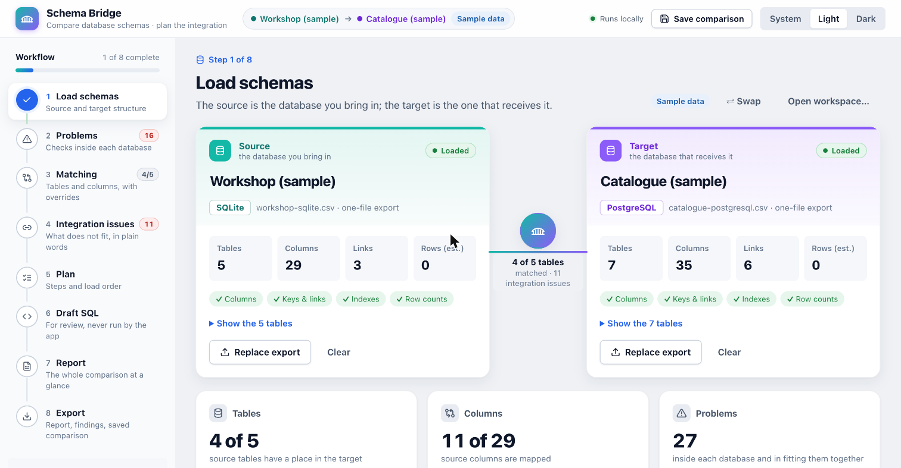
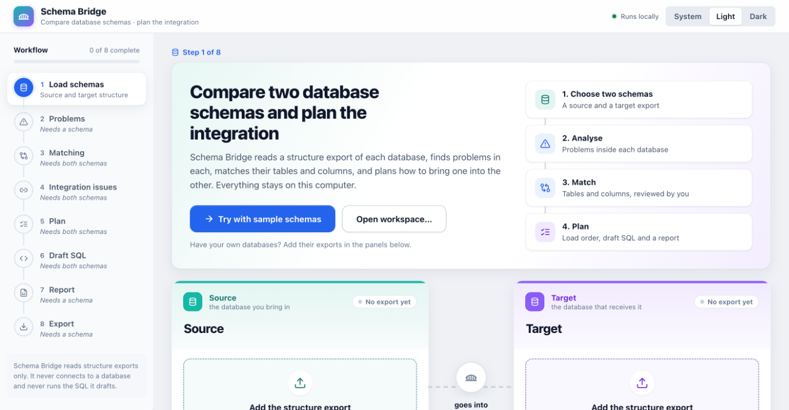
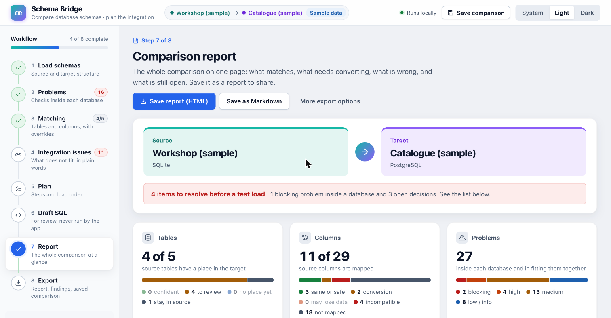
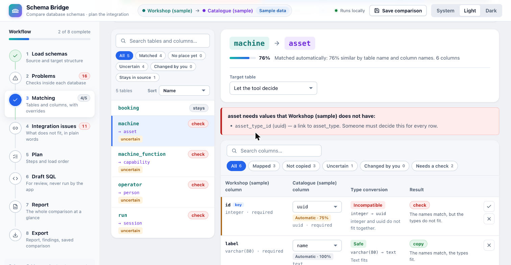
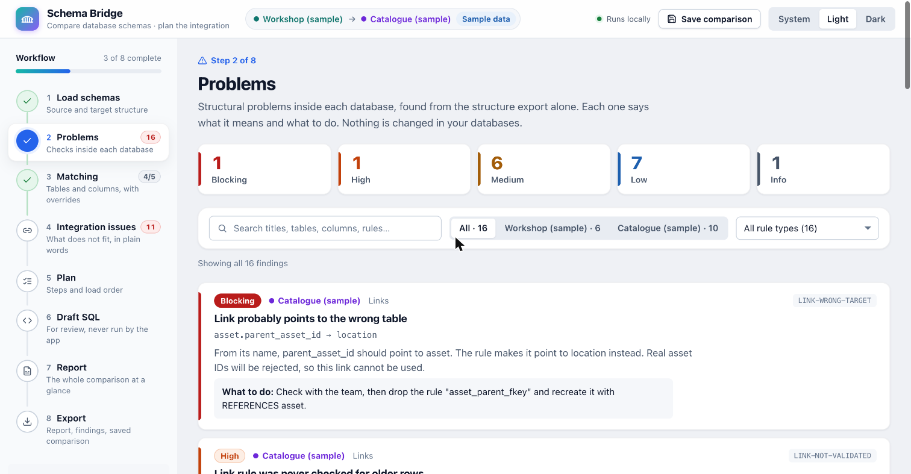
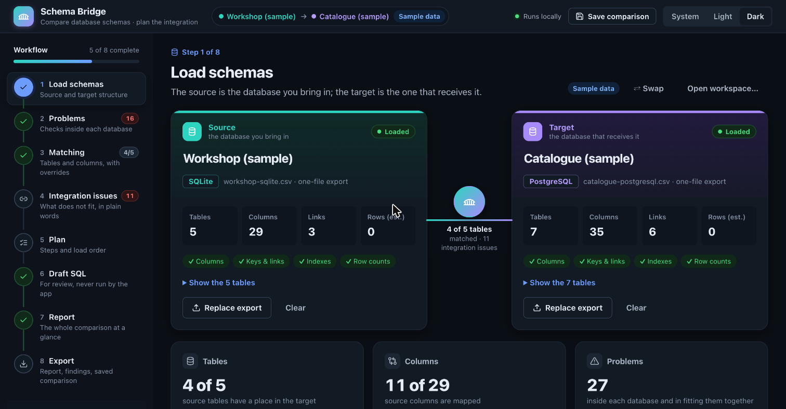
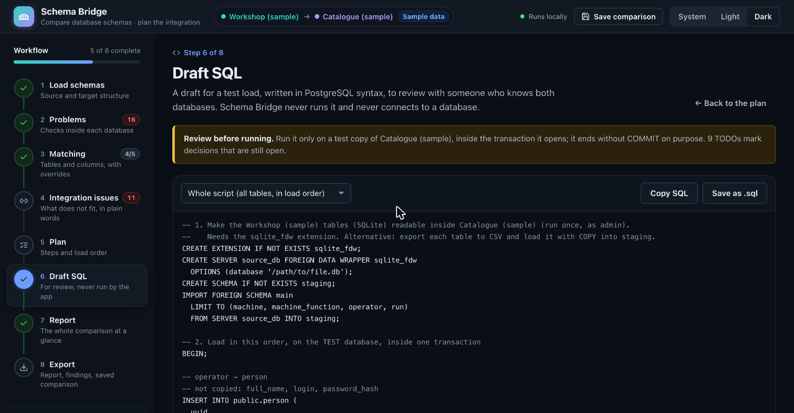

# Schema Bridge

Schema Bridge compares the structure of two databases, finds problems in each,
matches their tables and columns, and plans how to bring one into the other:
in which order to load the tables, what has to be decided first, and a draft
SQL script for a test load.

It works from a **structure export** of each database (tables, columns, keys,
links, indexes) that you make with one read-only query. It never connects to
a database, never reads table contents, never needs a password, and never runs
the SQL it drafts. Everything runs locally in your browser.



> **Status: first release candidate (0.1.0).** The whole workflow works
> end to end on PostgreSQL, MySQL/MariaDB, SQL Server, Oracle and SQLite
> exports. See [Limitations](#limitations) for what it does not do yet.

## The problem it solves

Bringing one database into another (a project database into a shared
catalogue, an old system into a new one) is mostly manual work: reading two
schemas side by side, guessing which tables match, and discovering broken
links, missing keys and type mismatches only when a load fails. Most of these
problems are visible in the database catalogue alone, so Schema Bridge finds
them before any data is moved, explains them in plain language, and turns the
result into a plan people can review.

## Workflow

| Stage | What you do |
| --- | --- |
| 1. **Load schemas** | Add the export of the *source* (the database you bring in) and the *target* (the one that receives it), or try the built-in sample schemas. |
| 2. **Problems** | Review problems inside each database (20 rules: missing keys, links to the wrong table, unchecked links, duplicates, time zones, secrets…). Search and filter by database, severity and rule. |
| 3. **Matching** | See which source table goes into which target table and every column's match, with the reason and confidence. Search, filter (matched, unmatched, uncertain, changed by you), accept, change or remove any match. Teach synonyms with the word list. |
| 4. **Integration issues** | What does not fit, in plain words: required columns with no source, relationships that do not line up, duplicates a unique column would reject, type risks. |
| 5. **Plan** | Six steps: fix the target, check the source, make the decisions, the load order, the test load, verification. |
| 6. **Draft SQL** | A reviewable `INSERT … SELECT` per table in load order, every open decision marked `TODO`. Copy or save it; Schema Bridge never runs it. |
| 7. **Report** | The whole comparison on one page, and as a shareable HTML or Markdown report. |
| 8. **Export** | Report, findings and mapping (CSV), draft SQL, and the saved comparison file to continue later. |

| | |
| --- | --- |
|  |  |
|  |  |
|  |  |

## Quick start

You need Rust and the Dioxus command-line tool; the
[installation guide](docs/installation.md) has step-by-step instructions for
macOS, Windows and Linux.

```sh
git clone https://github.com/IqraRaja/schema-bridge.git
cd schema-bridge
dx serve --package schema-bridge-app
```

Open **http://localhost:8080**, press **Try with sample schemas**, and follow
the stages from top to bottom. The [user guide](docs/user-guide.md) walks
through the sample comparison step by step.

To use your own databases, run the matching query from
[`export-queries/`](export-queries) in your usual database tool, save the
result as CSV and add it on the Load stage ("How to make an export file" on
that screen shows the steps for each system).

## Database systems

Schema Bridge's analysis is database-neutral: every import produces the same
neutral model, and matching, checks and planning never depend on the system a
schema came from. What is supported today, precisely:

| | Systems |
| --- | --- |
| **1. Types recognised and compared** | PostgreSQL, MySQL / MariaDB, SQL Server, Oracle, SQLite |
| **2. Schemas importable** | The same five, through one read-only export query each. Queries tested on real servers: PostgreSQL 16 and SQLite 3.45; the MySQL/MariaDB, SQL Server and Oracle queries are reviewed but not yet run on real servers. Any other relational system that can produce the same CSV columns can be loaded, but its type names are not specifically recognised. |
| **3. Planned adapters** | Time-series databases, starting with InfluxDB-style schemas (measurements, tags, fields, retention policies); a separate MariaDB adapter where it differs from MySQL; further relational systems. |
| **4. Not compared yet** | Views (names only), triggers and procedures, check constraint contents, generated columns, partitioning, permissions, and all time-series concepts. |

Details: [docs/databases.md](docs/databases.md). Adding a system:
[docs/adding-a-database.md](docs/adding-a-database.md).

## Privacy and safety

- Files you load stay in your browser; nothing is uploaded. There is no
  server component, account or telemetry.
- Exports contain structure only. The saved comparison file contains the
  exports, the word list and your choices, never passwords.
- The draft SQL is text for review: it targets a test copy, opens a
  transaction and leaves `COMMIT` commented out. Schema Bridge has no way to
  run it.

More: [docs/security-privacy.md](docs/security-privacy.md).

## Documentation

**For users**

- [Installation](docs/installation.md): prerequisites, macOS, Windows, Linux, running, updating.
- [User guide](docs/user-guide.md): a walk-through with the sample schemas and every stage explained.
- [Import formats](docs/import-formats.md): the export files and how to make them.
- [Database systems](docs/databases.md): what is recognised, importable, planned; time-series concepts.
- [Problem detection rules](docs/rules.md): every rule with its severity and meaning.
- [Matching](docs/matching.md): how tables and columns are matched, confidence, the word list.
- [Type compatibility](docs/type-compatibility.md): the five conversion levels with examples.
- [Integration plan and draft SQL](docs/integration-plan.md): the six steps, load order, SQL limits and safety.
- [Export and saved comparisons](docs/export.md): every export format and what it contains.
- [Security and privacy](docs/security-privacy.md)
- [Troubleshooting](docs/troubleshooting.md)

**For developers**

- [Architecture](docs/architecture.md): crates, modules, data flow, extension points.
- [Adding a database system](docs/adding-a-database.md)
- [Contributing](CONTRIBUTING.md): development setup, checks, tests, conventions.
- [Decisions](docs/decisions.md), [specification](docs/specification.md), [development plan](docs/development-plan.md)
- [Changelog](CHANGELOG.md)

## Testing

```sh
cargo test                     # 107 tests of the core library
cargo clippy --all-targets --all-features -- -D warnings
cargo clippy -p schema-bridge-app --target wasm32-unknown-unknown -- -D warnings
```

The tests cover import, type recognition, every problem rule, matching,
filters, manual overrides, integration findings, load order, draft SQL, the
report, the exports and the saved comparison file. Parity tests compare the
results with the original browser prototype on the sample schemas, and a
large-schema test checks that 400 × 400 tables are analysed quickly. No test
needs a database, network access or credentials. See
[CONTRIBUTING.md](CONTRIBUTING.md#tests).

## Limitations

- Schemas come from export files; there are no direct database connections
  (an open decision, specification FR-01).
- The draft SQL is PostgreSQL syntax; for other targets it is a
  column-by-column guide. CSV staging is described but not generated.
- Findings are risks read from the structure. Counting queries that confirm
  them on the data are not generated yet, and rules cannot be switched off.
- Exports are CSV, Markdown and HTML; there is no Excel file.
- The MySQL/MariaDB, SQL Server and Oracle export queries have not been run
  on real servers yet.
- Time-series databases cannot be imported yet (the model has the extension
  points, see [docs/databases.md](docs/databases.md#time-series-databases)).
- English only. The application has been tested on macOS with Chrome; the
  Windows and Linux instructions follow the official Rust and Dioxus setup
  but have not been tried on a clean machine yet.

## Project structure

```
schema-bridge/
├── crates/schema-bridge-core/   Library: all logic, no UI, fully tested
├── crates/schema-bridge-app/    Dioxus application (runs in the browser)
├── demo/                        Made-up sample databases, exports, word list
├── export-queries/              One read-only structure query per system
└── docs/                        User and developer documentation
```

## License

Schema Bridge is released under the [MIT License](LICENSE).
Copyright (c) 2026 Iqra Naz.
