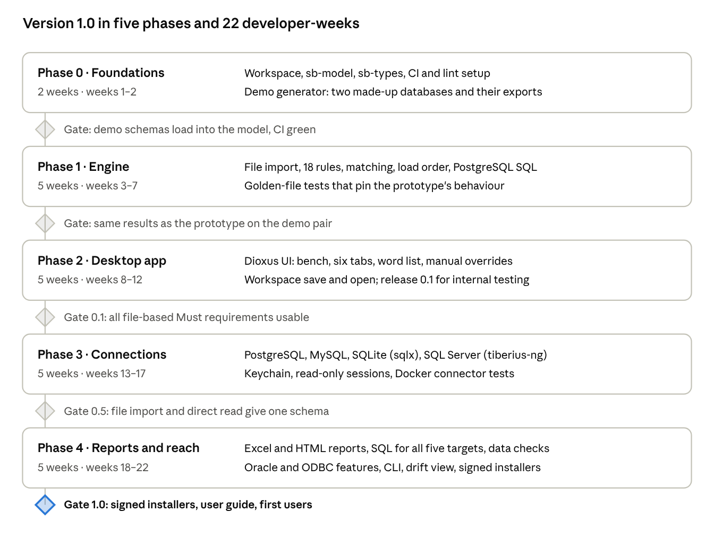

# Schema Bridge — Development plan

Originally section 12 of the [specification](specification.md), written
22 October 2026. The plan below is kept as written; [Progress](#progress) at
the end records what has been done and is updated with every milestone.

## The plan

Version 1.0 takes about 22 developer-weeks in five phases, assuming one developer working full time; at half time, plan for roughly 10 to 11 months. Each phase ends in a gate that can be demonstrated, and the engine is finished before the UI so the UI never waits on logic.

Roadmap · 5 phases, 22 developer-weeks, a gate after each

The file-based app is usable after week 12 (release 0.1); direct connections arrive at 0.5, and 1.0 adds reports, all SQL dialects, Oracle, ODBC and the CLI.

**Working rules for the whole plan**

- Port the prototype's behaviour first, then improve it: Phase 1 is done only when the Rust engine gives the same findings, matches and load order as the prototype on the demo pair.

- One pull request per rule, connector or dialect, each with its tests.

- Keep a changelog and tag a release at every gate, so supervisors can try each stage.

- Real institute databases are used only locally for acceptance testing, never committed (section 10).

## Progress

*Updated 24 October 2026 (release pass).*

The work is delivered in small milestones, each checked with `cargo fmt`,
`cargo check` and `cargo test` before the next one starts. They map onto the
plan's phases as follows.

| Milestone | Content | Plan phase | State |
| --- | --- | --- | --- |
| 1 | Schema model and import of structure exports (one-file and four-file), parity with the prototype | Phase 0 (`sb-model`) and Phase 1 (file import) | Done |
| 2 | Type recognition and compatibility for five systems, parity with the prototype | Phase 0 (`sb-types`) | Done |
| App shell | Dioxus application: load two schemas, side-by-side overview, workflow navigation, sample schemas on request | Part of Phase 2, brought forward | Done; first build happens on the owner's machine |
| 3 | Problem detection in each database (rule catalogue, §7), with its screen | Phase 1 + Phase 2 | Done; parity with the prototype on both samples and a coverage fixture |
| 4 | Table and column matching, word list, overrides, with its screen | Phase 1 + Phase 2 | Done; parity with the prototype on the sample pair in three situations |
| 5 | Integration issues, load order and draft SQL, with their screens | Phase 1 + Phase 2 | Done; parity with the prototype on the sample pair in three situations |
| 6 | Export of findings and mapping; workspace file | Phase 4 (reports) + FR-04 | Done: CSV, Markdown report, workspace file; Excel and HTML not yet |

**Added requirements (24 October 2026)**

Two requirements were added after milestone 6. They extend the plan; the
completed milestones stay as they are.

*Database coverage.* Schema Bridge must work with relational and
time-series databases through separate adapters, behind a clean boundary, so
the comparison, matching, analysis and planning engines never change when a
system is added. Systems in scope: PostgreSQL, MySQL, MariaDB, SQL Server,
Oracle, SQLite, InfluxDB / InfluxDB-style time-series schemas, and other
time-series systems later. Time-series concepts (measurements, fields,
tags/labels, timestamps, retention policies and other metadata) must be
represented in the model where they apply, not squeezed into tables if that
loses information. Adapters are added one at a time; the documentation
distinguishes supported import formats, planned adapters, and features that
cannot be compared yet, and never claims more than is implemented.

*Documentation as part of the product.* An external user must be able to
understand, install and test Schema Bridge without help. Every major
feature gets user-facing documentation (how to use it) and developer-facing
documentation (how it works), with examples a new user can follow, kept in
step with the implementation.

| Milestone | Content | State |
| --- | --- | --- |
| 6a | Adapter boundary, first part: everything system-specific moved into one registry (`systems.rs`), neutral fallback for unknown systems, architecture and adapter guide, README split into recognised / importable / planned | Done |
| 6b | Release pass: report stage and HTML/Markdown report, search and filters everywhere, review states with confidence and accept/remove/reset, type-fit explanations, large-schema performance, time-series extension points in the model, full documentation set with screenshots | Done |
| 7 | Adapter boundary, second part: a workspace slot holds a general input instead of the CSV export files, and importers share one interface that produces the neutral model; the workspace file records which importer was used | Done (decision 23): `SchemaInput`, `Importer`, saved comparison format version 2, version 1 still opens |
| 8 | Time-series model and the first time-series adapter: design how measurements, tags, fields, timestamps and retention policies sit next to tables (decision first, then code); an InfluxDB-style schema import; checks, matching and plan rules that understand them; a made-up time-series sample | Next |
| 9 | Relational adapters: a separate MariaDB entry where it differs from MySQL; run the MySQL, SQL Server and Oracle export queries on real servers and fix what they show | Planned |
| 10 | Documentation set (below), with screenshots, completed and checked by following it on a clean machine for Windows, macOS and Linux | Planned; parts are written with each milestone |

Open items from earlier milestones remain: the FR-01 decision, Excel and
HTML exports, generated CSV staging, SQL for targets other than PostgreSQL,
and listing the links that form a cycle.

**Documentation set.** Present: README with screenshots and quick start,
[installation](installation.md) (macOS, Windows, Linux), [user guide](user-guide.md)
(walk-through and every stage), [import formats](import-formats.md),
[databases](databases.md) (including time-series concepts), [rules](rules.md),
[matching](matching.md), [type compatibility](type-compatibility.md),
[integration plan and draft SQL](integration-plan.md), [export](export.md),
[security and privacy](security-privacy.md), [troubleshooting](troubleshooting.md),
[architecture](architecture.md), [adding a database](adding-a-database.md),
[CONTRIBUTING](../CONTRIBUTING.md), [CHANGELOG](../CHANGELOG.md), and the
[MIT License](../LICENSE). Still open: trying the Windows and Linux
instructions on clean machines (milestone 10).

**Departures from the plan's approach**

- **Engine and screens together.** The plan finishes the engine before the UI.
  At the owner's request the application shell was built early so the
  workflow can be reviewed in the browser, and each following milestone adds
  one part of the engine together with its screen.
- **Phase 0 items not done yet:** CI and lint setup. The sample databases
  exist as files with their SQL (`demo/`) instead of a generator crate.
- **Phase 3 (direct connections)** depends on the open decision about FR-01;
  see [Where the implementation currently differs](specification.md#where-the-implementation-currently-differs).

**Gate status.** Phase 1's gate asks for the same results as the prototype on
the sample pair. This holds today for the model, types, findings, matches,
integration findings, load order and draft SQL.

