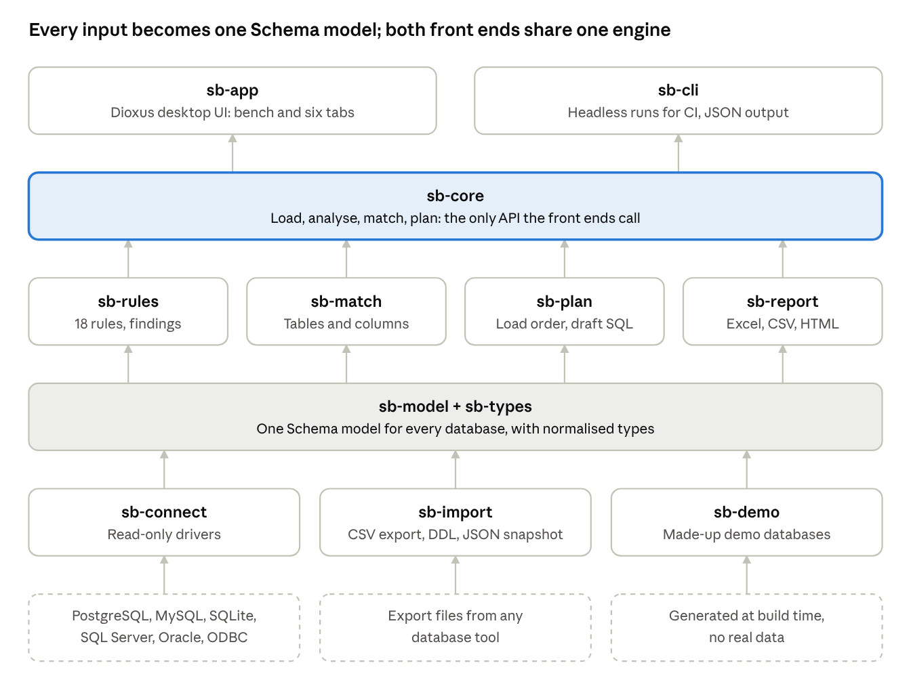

# Schema Bridge — Specification

Written 22 October 2026, before the Rust implementation started.

> **How to read this document.** This is the specification Schema Bridge is
> built against, and it is the source of truth for requirements. Its text is
> kept as written. Where the current implementation differs, the difference is
> listed in [Where the implementation currently differs](#where-the-implementation-currently-differs)
> at the end instead of being changed in the text. The development plan
> (section 12) is in [development-plan.md](development-plan.md); technical
> decisions taken during development are in [decisions.md](decisions.md).

## 1. Purpose and scope

Schema Bridge is a desktop application, written in Rust with Dioxus, that compares the structure of two databases, finds problems in each, and produces a reviewable plan for moving one database into the other. It turns an earlier browser prototype into a maintained tool that any team can use on any pair of databases. It ships with a made-up demo database pair, so a new user can see every feature before loading their own databases.

**Problem it solves.** Integrating one database into another is mostly manual today: people read two schemas side by side, guess which tables match, and discover broken links, missing keys and type mismatches only when a load fails. The prototype showed that most of this can be checked automatically from the database catalogue alone (on one real pair of research databases it found 81 issues, 2 of them blocking, in seconds).

**Goals**

- Read the structure of two databases, either by a direct read-only connection or from a one-file catalogue export.

- Report problems inside each database and problems in fitting them together, in plain language with a suggested fix.

- Match tables and columns across the two, with user corrections and a reusable word list.

- Produce an integration plan: decisions to make, load order, and draft SQL in the target's dialect.

- Keep all data and credentials on the user's computer.

**Non-goals (first release)**

- Moving data. Schema Bridge plans and drafts the migration; it does not run it against production.

- Editing either database's schema.

- A hosted multi-user web service. A web build may come later for file-based use only.

- Checking the content of every row. Data-level checks are limited to optional counting queries the user runs on demand.

## 2. Users and use cases

The primary user is a data or database engineer preparing an integration; the secondary user is the person who must approve it.

| User                       | What they need from Schema Bridge                                                                                  |
|----------------------------|--------------------------------------------------------------------------------------------------------------------|
| Data / database engineer   | Load two databases, find every structural problem, correct the table and column matching, export a migration draft |
| Supervisor or data owner   | A one-screen overview and a short list of decisions, without reading SQL                                           |
| Database administrator     | The exact fix statements for problems inside their own database                                                    |
| Research software engineer | The same checks run headless in CI, to catch schema drift between releases                                         |

**Main use cases**

1.  **Integration assessment.** Compare a project database with a shared catalogue database and decide what moves, what stays and what must change first.

2.  **Schema health check.** Load one database alone and get its problem list (missing keys, unchecked links, duplicate identifiers, sensitive columns).

3.  **Drift check.** Compare two versions of the same database (TEST vs production, or last month vs today) and list what changed.

4.  **Cross-system migration.** Plan a move between different systems, for example MySQL → PostgreSQL, including type conversions.

5.  **Hand-over report.** Export the findings and mapping as a spreadsheet and a short report for a meeting.

## 3. Functional requirements

The first release needs the 13 "Must" requirements; they reproduce and harden what the prototype already does. "Should" items follow in later milestones (section 12).

| ID     | Requirement                                                                                                                                                                                                                                            | Priority |
|--------|--------------------------------------------------------------------------------------------------------------------------------------------------------------------------------------------------------------------------------------------------------|----------|
| FR-01  | Connect directly to a database through a read-only session and read its catalogue                                                                                                                                                                      | Must     |
| FR-02  | Import the one-file catalogue export (the prototype's 21-column CSV) for every supported system                                                                                                                                                        | Must     |
| FR-02a | Ship a built-in demo: two made-up databases (a small workshop inventory and a catalogue) that open on first start and contain no real data. Users replace them with their own exports; nothing about the user's databases is ever bundled with the app | Must     |
| FR-03  | Import a DDL script (for example pg_dump --schema-only) as a third source type                                                                                                                                                                         | Could    |
| FR-04  | Save and reopen a workspace file holding both schemas, the word list and all manual choices                                                                                                                                                            | Must     |
| FR-05  | Save a schema snapshot (JSON) to compare later versions of the same database                                                                                                                                                                           | Should   |
| FR-06  | Run the rule catalogue on each database: keys, links, duplicates, time types, sensitive columns, naming, descriptions                                                                                                                                  | Must     |
| FR-07  | Explain every finding in plain language with a fix written in that database's own SQL dialect                                                                                                                                                          | Must     |
| FR-08  | Let users switch rules off and change their severity, saved per workspace                                                                                                                                                                              | Should   |
| FR-09  | Generate and, with explicit consent, run read-only counting queries that confirm a finding (orphans, duplicates, empty values)                                                                                                                         | Should   |
| FR-10  | Match tables and columns automatically from names, synonyms, descriptions, types and key structure                                                                                                                                                     | Must     |
| FR-11  | Edit, import and export the word list (synonyms, table pairs, skip rules)                                                                                                                                                                              | Must     |
| FR-12  | Override any table or column match by hand and keep the override across sessions                                                                                                                                                                       | Must     |
| FR-13  | Check that mapped links line up (a source link must land on the matching target link)                                                                                                                                                                  | Must     |
| FR-14  | Flag required target columns that nothing in the source can fill                                                                                                                                                                                       | Must     |
| FR-15  | Compute the load order from the target's links, and report cycles                                                                                                                                                                                      | Must     |
| FR-16  | Generate draft migration SQL for a PostgreSQL target, with every open decision marked TODO                                                                                                                                                             | Must     |
| FR-17  | Generate draft SQL for MySQL, SQL Server, Oracle and SQLite targets                                                                                                                                                                                    | Should   |
| FR-18  | Export findings and the mapping matrix to Excel and CSV, and a short report to HTML or Markdown                                                                                                                                                        | Should   |
| FR-19  | Show the differences between two snapshots of the same database (drift view)                                                                                                                                                                           | Should   |
| FR-20  | Command-line tool with the same engine: JSON output and a non-zero exit code when blocking issues exist                                                                                                                                                | Should   |
| FR-21  | Optional AI assistant that proposes matches for German/English or abbreviated names, always as suggestions                                                                                                                                             | Could    |

## 4. Supported databases

No tool can ship a driver for every database, so Schema Bridge reads databases through three routes: native drivers for the five common systems, ODBC for any database that has an ODBC driver, and file import for everything else. Every route produces the same internal schema model (section 6), so the analysis never depends on where the schema came from.

| Database                                                                           | Route in release 1          | Rust crate                                                                                                                  | Notes                                                                                                                                           |
|------------------------------------------------------------------------------------|-----------------------------|-----------------------------------------------------------------------------------------------------------------------------|-------------------------------------------------------------------------------------------------------------------------------------------------|
| PostgreSQL (incl. PostGIS, TimescaleDB)                                            | Native driver + file import | [sqlx](https://github.com/launchbadge/sqlx)                                                                                 | Reference system; export query already tested on PostgreSQL 16                                                                                  |
| MySQL / MariaDB                                                                    | Native driver + file import | [sqlx](https://github.com/launchbadge/sqlx)                                                                                 | Export query reviewed, not yet run on a real server                                                                                             |
| SQLite                                                                             | Native driver + file import | [sqlx](https://github.com/launchbadge/sqlx)                                                                                 | Export query tested on SQLite 3.45                                                                                                              |
| Microsoft SQL Server / Azure SQL                                                   | Native driver + file import | [tiberius-ng](https://users.rust-lang.org/t/tiberius-ng-a-maintained-continuation-of-the-tiberius-sql-server-driver/142157) | sqlx removed SQL Server support from 0.7; the original tiberius crate is unmaintained, so use the maintained fork or the ODBC route             |
| Oracle 12c+                                                                        | Native driver + file import | [oracle](https://github.com/kubo/rust-oracle)                                                                               | Needs Oracle client libraries 11.2+ on the user's machine; ship as an optional feature                                                          |
| Any database with an ODBC driver (Db2, SAP HANA, Snowflake, Teradata, Informix, …) | ODBC                        | [odbc-api](https://github.com/pacman82/odbc-api)                                                                            | Reads tables, columns and keys through the standard ODBC catalogue functions; fewer details (no comments, no index definitions on some drivers) |
| Anything else                                                                      | File import                 | —                                                                                                                           | One-file CSV export, a DDL script, or a JSON snapshot written by another tool                                                                   |

**Adding a database later** means implementing one connector trait and one type-mapping table (section 5). Non-relational stores such as MongoDB are out of scope for release 1; they would need a schema inferred by sampling documents, which is a different kind of input.

**What each route must deliver**, as a minimum: tables and views, columns with type, nullability and default, primary keys, unique keys, foreign keys with their delete rule and whether they are enforced, and index columns. Comments, check constraints, triggers and row estimates are read where the database offers them; the analysis skips rules whose input is missing and says so.

## 5. Architecture

Schema Bridge is one Cargo workspace: a database-neutral engine split into small library crates, with two thin front ends on top — a Dioxus desktop app and a command-line tool. All analysis is pure Rust over the in-memory schema model, so the same engine runs in the desktop app, in CI and in tests without a database.

Crate architecture · data flows upward from sources to the two front ends

Data flows upward: drivers, files and the demo all produce the same Schema model, the engine works only on that model, and the desktop app and CLI call only sb-core.

| Crate      | Responsibility                                                                   | Main dependencies                          |
|------------|----------------------------------------------------------------------------------|--------------------------------------------|
| sb-model   | Schema model, findings, mappings, workspace file format                          | serde, serde_json                          |
| sb-types   | Normalises each dialect's type names into one type model; type compatibility     | —                                          |
| sb-connect | Connector trait and one implementation per database, each behind a Cargo feature | sqlx, tiberius-ng, oracle, odbc-api, tokio |
| sb-import  | One-file CSV export, legacy 4-file export, DDL scripts, JSON snapshots           | csv, sqlparser                             |
| sb-rules   | Rule catalogue: each rule is a type implementing Rule, producing findings        | sb-model, sb-types                         |
| sb-match   | Name tokenising, word list, scoring and table/column assignment                  | sb-model                                   |
| sb-plan    | Required-field check, load order, draft SQL per target dialect                   | petgraph                                   |
| sb-report  | Excel, CSV, HTML and Markdown exports                                            | rust_xlsxwriter                            |
| sb-core    | Orchestration: load, analyse, match, plan; the only API the front ends call      | all of the above                           |
| sb-demo    | Builds the two made-up demo databases and their exports                          | sqlx (SQLite)                              |
| sb-app     | Dioxus desktop UI                                                                | dioxus 0.7 (desktop)                       |
| sb-cli     | Headless runs for CI, JSON output                                                | clap                                       |

**Key interfaces** (sketch, final names may change):

pub trait Connector: Send + Sync {  
fn dialect(&self) -\> Dialect;  
/// Reads the catalogue only. Must open a read-only session.  
async fn read_schema(&self, opts: &ReadOptions) -\> Result\<Schema, ConnectError\>;  
/// Runs one generated counting query (orphans, duplicates, empty values).  
async fn run_check(&self, check: &CheckQuery) -\> Result\<CheckResult, ConnectError\>;  
}  
  
pub trait Rule {  
fn id(&self) -\> &'static str; // e.g. "LINK-NOT-VALIDATED"  
fn default_severity(&self) -\> Severity;  
fn check(&self, schema: &Schema, ctx: &RuleCtx) -\> Vec\<Finding\>;  
}  
  
pub trait SqlDialect {  
fn quote_ident(&self, name: &str) -\> String;  
fn cast(&self, expr: &str, to: &TypeInfo) -\> String;  
fn validate_constraint(&self, table: &TableRef, name: &str) -\> String;  
fn insert_select(&self, plan: &TablePlan) -\> String;  
}

**Why Dioxus desktop first.** A desktop app keeps credentials and schemas on the user's computer, can open direct database connections, and needs no server to operate. Dioxus 0.7 is the current stable line ([releases](https://github.com/DioxusLabs/dioxus/releases); 0.7.10, July 2026), with 0.8 in alpha; pin 0.7 and plan one upgrade window. A web build of the same UI can follow later for file-import-only use, because the engine crates compile without the connector features.

## 6. Data model

Every connector and importer produces the same Schema value; nothing downstream knows which database it came from. Types keep both the original spelling (shown to users) and a normalised form (used by the analysis), which is what made cross-system comparison work in the prototype.

pub struct Schema {  
pub source: SourceInfo, // dialect, server version, how it was read, read_at  
pub tables: Vec\<Table\>, // tables and views; key = (schema, name)  
pub capabilities: Capabilities, // which facts this route could deliver  
}  
  
pub struct Table {  
pub schema: String,  
pub name: String,  
pub kind: TableKind, // Table \| View \| MaterializedView \| Partitioned  
pub comment: Option\<String\>,  
pub columns: Vec\<Column\>,  
pub primary_key: Option\<Key\>,  
pub unique_keys: Vec\<Key\>,  
pub foreign_keys: Vec\<ForeignKey\>,  
pub checks: Vec\<Check\>,  
pub indexes: Vec\<Index\>,  
pub row_estimate: Option\<i64\>, // None = unknown, never 0  
pub triggers: Vec\<String\>,  
}  
  
pub struct Column {  
pub name: String,  
pub position: u32,  
pub type_label: String, // as the database spells it: "nvarchar(50)"  
pub ty: TypeInfo, // normalised: Text { max: Some(50) }  
pub nullable: bool,  
pub default: Option\<String\>,  
pub generated: bool, // identity, serial, auto_increment  
pub comment: Option\<String\>,  
}  
  
pub struct ForeignKey {  
pub name: String,  
pub columns: Vec\<String\>,  
pub references: TableRef,  
pub referenced_columns: Vec\<String\>,  
pub on_delete: RefAction,  
pub enforced: Enforcement, // Enforced \| NotValidated \| Disabled  
}  
  
pub enum TypeInfo {  
Bool, Int { bytes: u8 }, Float { bytes: u8 }, Decimal { precision: Option\<u32\>, scale: Option\<u32\> },  
Text { max: Option\<u32\> }, Uuid, Date, Time, Timestamp { tz: bool }, Interval,  
Json, Xml, Binary, Array(Box\<TypeInfo\>), Enum(Vec\<String\>), Other(String),  
}

**Mapping and workspace.** A Mapping holds, per source table, the chosen target table and how it was chosen (automatic with score, word list, or user), and per column the chosen target column. A Workspace bundles both schemas, the word list, rule settings, user overrides and the last results. It is saved as one versioned JSON file (.sbridge) so a colleague can open exactly the same analysis. The workspace never stores passwords (section 10).

**Type normalisation** lives in sb-types as one table per dialect, covering at least the cases the prototype already handles: tinyint(1) and bit as Bool, Oracle NUMBER(p,0) as Int by precision, Oracle DATE as Timestamp without time zone, SQL Server timestamp as Binary (it is a row version), datetimeoffset and timestamptz as Timestamp with time zone, and SQLite's type-affinity rules for free-form type names.

## 7. Analysis engine

The engine runs three stages in order — rules on each database, matching between them, then integration checks on the matches — and every stage is deterministic: the same inputs always give the same findings, so results can be compared over time and tested.

**Severity scale.** Blocking (a load will fail or store wrong data), High (affects correctness), Medium (needs a decision or a data check), Low (quality, speed, naming), Info (context). Every finding carries: rule id, severity, database, object path, title, plain-language explanation, a fix in the right dialect, and whether it is a schema risk or was confirmed by a data check.

**Rule catalogue for release 1** (all already proven in the prototype):

| Rule ID                  | Detects                                                                              | Default severity |
|--------------------------|--------------------------------------------------------------------------------------|------------------|
| KEY-MISSING-PK           | Table without a primary key                                                          | High             |
| LINK-WRONG-TARGET        | Foreign key whose column name points to a different table than the one it references | Blocking         |
| LINK-NOT-VALIDATED       | Foreign key not checked for existing rows (NOT VALID, untrusted or disabled)         | High             |
| LINK-IMPLICIT            | Column that looks like a link (\*\_id, uuid\_\*, uuid type) with no foreign key      | Medium           |
| LINK-SHARED-CODE         | Same code column (\*\_nr, \*\_code, \*\_type) in several tables with no lookup table | Medium           |
| LINK-ID-ARRAY            | Array of IDs that cannot be checked                                                  | Low              |
| DUP-IDENTIFIER           | Identifier-like column (DOI, ORCID, email, serial number) without a unique rule      | Medium           |
| DUP-NULLABLE-UNIQUE      | Unique column that may be empty                                                      | Low              |
| KEY-SURROGATE-NOT-UNIQUE | Extra id column beside a composite primary key, not unique                           | Medium           |
| TIME-MIXED-TZ            | Time columns with and without time zone in one table                                 | Medium           |
| DATA-MULTI-FORMAT        | Same data stored in several formats (\*\_xml, \*\_json, \*\_bytea)                   | Medium           |
| SEC-SENSITIVE            | Column that looks like a password, token or secret                                   | High             |
| PERF-FK-NO-INDEX         | Foreign key column without a supporting index                                        | Low              |
| PERF-DUP-INDEX           | Two indexes on the same columns                                                      | Low              |
| NAME-RESERVED            | Names that are SQL reserved words                                                    | Low              |
| NAME-MISLEADING          | Constraint names that contradict their type (fk\_ on a primary key)                  | Low              |
| DOC-COVERAGE             | Share of columns with a description                                                  | Low / Info       |
| CONTENT-EMPTY            | Tables with no rows, or statistics never collected                                   | Info             |

**Matching algorithm.**

1.  Split every table and column name into tokens (snake_case, camelCase), lower-case them, drop plural endings, and map them through the word list (component = device).

2.  Score each source/target table pair: token similarity of names (Dice coefficient, weight 0.6) plus the share of source columns that have a close name match in the target (weight 0.4). An exact name scores 1.

3.  Apply, in order of strength: user overrides, word-list table pairs and skip rules, then the best automatic match if its score is at least 0.55.

4.  For each matched pair, score column pairs on name similarity, description similarity (weight 0.1) and type fit (+0.1 if compatible, −0.25 if not). Never auto-fill a target foreign key from a plain source column.

5.  Assign greedily from the highest score, each target column used once, threshold 0.65. Store the score and the reason with every match so the UI can explain it.

**Type compatibility** has five levels: same, safe (fits without loss), convert (needs an explicit conversion or lookup), loss (values may be cut, rounded or lose a time zone), incompatible. Text into a UUID column is always a lookup, never a cast.

**Integration checks** run on the matches: required target columns with no source (Blocking if it is a link, else High), relationships that do not line up, unique target columns fed from non-unique source columns, nullable into required, type loss, tables with no target, several sources into one target, and no place to store the source ID.

## 8. Integration plan and SQL generation

The plan is a fixed six-step sequence the user works through, and the SQL is a draft for review: every unresolved decision appears as a TODO in the script, and the script always runs inside a transaction that ends in a commented-out COMMIT.

1.  **Fix the target.** Blocking and High findings inside the target database, each with its fix statement.

2.  **Check the source.** Blocking and High findings in the source, plus the counting queries that confirm them (FR-09).

3.  **Make the decisions.** Required fields with no source, relationships that do not line up, tables with no place in the target.

4.  **Load order.** Topological sort of the target tables that receive data, plus their required parent tables (which must already hold rows). Cycles are reported with the links that form them and a suggestion to load in two passes (insert, then update the link).

5.  **Test load.** Draft SQL in the target's dialect.

6.  **Verify.** Row counts per table, link checks, a second run that must change nothing, and a manual spot check.

**How source data reaches the target.** The generated script offers two staging options and the user picks one:

| Option                                        | When to use                                           | What Schema Bridge generates                                                                                                                    |
|-----------------------------------------------|-------------------------------------------------------|-------------------------------------------------------------------------------------------------------------------------------------------------|
| Foreign data wrapper (PostgreSQL target only) | Target can reach the source over the network          | CREATE SERVER and IMPORT FOREIGN SCHEMA for postgres_fdw, mysql_fdw, tds_fdw, oracle_fdw or sqlite_fdw                                          |
| CSV staging (any target)                      | No network path, or the extension cannot be installed | One SELECT per source table to export, and the target's own bulk-load command (COPY, LOAD DATA, BULK INSERT, SQL\*Loader control file, .import) |

**Per target table** the script contains: an INSERT … SELECT with one line per mapped column, casts where the type level is "convert", lookups (sub-selects) where text must become an ID, NULL /\* TODO \*/ for required columns without a source, and the source system, table and ID stored in a JSON column when the target has one, otherwise in a generated mapping table. The SqlDialect trait (section 5) holds everything dialect-specific: identifier quoting, casts, time-zone conversion, JSON building, upsert syntax and constraint validation.

**Re-runnable loads.** Release 2 adds an upsert mode that uses the stored source IDs, so a second run updates instead of duplicating.

## 9. User interface

The desktop app keeps the prototype's layout, which tested well: a Source → Target bench at the top and six tabs below. On first start it opens the made-up demo pair with a clear "Demo data" label and a "Load your own databases" button; demo data never mixes with a user's workspace.

| Screen                 | Purpose                                                                                                | Key components                      |
|------------------------|--------------------------------------------------------------------------------------------------------|-------------------------------------|
| Start                  | Open a workspace, start a new one, or open the demo                                                    | RecentWorkspaces, DemoCard          |
| Bench (always visible) | One slot per database: name, system, how it was read, counts, reload                                   | DbSlot, ConnectDialog, ImportDialog |
| Overview               | One-screen summary for a supervisor: problem counts, column coverage, side-by-side facts, top problems | SeverityBars, CoverageBar, FactGrid |
| Problems               | Filterable list of findings with explanation and fix; mark as confirmed, not an issue, or fixed        | FindingList, FindingCard, Filters   |
| Table matching         | Source tables grouped by status; column grid with target pickers, types, notes and descriptions        | TableList, ColumnGrid, MatchPicker  |
| Integration plan       | The six steps, load-order strip, draft SQL with copy and save                                          | PlanSteps, LoadOrder, SqlView       |
| Word list              | Rule editor with validation and live preview of what each rule changes                                 | WordListEditor                      |
| Settings               | Rules on/off and severity, theme, language (English and German)                                        | RuleSettings                        |

**Connect dialog.** Choose the system, enter host, port, database and user, then test the connection. The password goes to the operating system's keychain only if the user ticks "remember"; otherwise it lives in memory for the session. The dialog states plainly that the connection is read-only and only reads the structure.

**State and responsiveness.** UI state uses Dioxus signals; one Workspace signal is the single source of truth. Connecting, reading and analysing run on background tasks so the window never freezes; long reads show progress per step (tables, columns, keys, indexes) and can be cancelled. Analysis results are recomputed when inputs change and cached per input hash.

**Accessibility and language.** Keyboard navigation for every action, visible focus, colour never the only signal (severity also shown as a word), light and dark themes, and all user-facing strings in one translation file so German can be added in release 1.

## 10. Security and privacy

Schema Bridge must be safe to use on internal research and production databases: it reads structure only, never changes a database, and nothing leaves the user's computer unless the user exports it.

- **Read-only by construction.** Every connector opens a read-only session where the database supports it (SET TRANSACTION READ ONLY, ApplicationIntent=ReadOnly, SQLite mode=ro) and only runs catalogue queries. Generated SQL is shown and saved, never executed by the app. The only queries it runs on user data are the counting checks of FR-09, listed in full and run after an explicit confirmation.

- **Least privilege.** Documentation tells admins which catalogue rights each system needs, so a dedicated read-only user is enough.

- **Credentials.** Never written to workspace files, logs or exports. Stored only in the OS keychain (Windows Credential Manager, macOS Keychain, Secret Service on Linux) when the user asks. Connections use TLS by default, with a visible warning when the user turns it off.

- **No network calls of its own.** No telemetry and no update checks without opt-in. The optional AI assistant (FR-21) is off by default, sends only the names and descriptions the user selects, and shows exactly what will be sent.

- **Sensitive columns.** Columns flagged by SEC-SENSITIVE are excluded from generated SQL unless the user includes them by hand.

- **No real data in the product.** The built-in demo is generated from made-up schemas. Test fixtures are made up too; no customer or institute schema is ever committed to the repository.

- **Shareable outputs.** Exports contain schema details, which organisations may treat as internal. The export dialog says so and offers to leave out comments and row counts.

- **Supply chain.** cargo deny for licences and advisories, cargo audit in CI, pinned dependencies, signed release builds.

## 11. Quality, testing and packaging

The engine is tested without databases, and each connector is tested against a real database in a container, so a rule or matching change can never silently alter results.

| Target                            | Value                                           |
|-----------------------------------|-------------------------------------------------|
| Schema size handled               | 2,000 tables and 50,000 columns per database    |
| Full analysis of two such schemas | Under 2 seconds on a 2023 laptop                |
| Catalogue read over the network   | Under 30 seconds for 2,000 tables               |
| App start to demo shown           | Under 2 seconds                                 |
| Installer size                    | Under 40 MB without the optional Oracle feature |

**Testing strategy**

- **Unit tests** for every rule, type mapping and SQL dialect function.

- **Golden-file tests**: fixed made-up schema pairs with the expected findings, matches and SQL stored as JSON and SQL files; any change to output shows as a reviewable diff (for example with insta snapshots).

- **Connector integration tests** in CI against Docker images of PostgreSQL, MySQL, MariaDB and SQL Server, plus SQLite files; Oracle Free in a nightly job because its image is large.

- **Round-trip test**: the file export and the direct connection of the same database must give an identical Schema.

- **Property tests** for the tokenizer and the load-order sort (no table before its parents, cycles always reported).

- **UI smoke tests** of the main flows (open demo, load files, change a match, copy SQL).

**Packaging.** Signed installers for Windows (MSI), macOS (DMG, notarised) and Linux (AppImage and .deb) built by dx bundle in CI. The CLI ships as a single binary per platform. Oracle and ODBC support are build features, so the default installer needs no extra system libraries.

## 12. Development plan

This section is kept in its own file: [development-plan.md](development-plan.md).

## 13. Risks and open questions

The largest risks are in the drivers for SQL Server and Oracle and in how far ODBC catalogue information goes; all three are isolated behind the connector trait, so the file-import route keeps the product usable if one of them slips.

| Risk                                                                                 | Impact                                 | Mitigation                                                                                |
|--------------------------------------------------------------------------------------|----------------------------------------|-------------------------------------------------------------------------------------------|
| SQL Server driver: the original tiberius is unmaintained and sqlx dropped SQL Server | No direct SQL Server connection        | Use tiberius-ng; fall back to ODBC with Microsoft's driver; file import always works      |
| Oracle needs client libraries installed on the user's machine                        | Harder installation                    | Optional build feature and installer; file import from SQL Developer as the default       |
| ODBC drivers differ in which catalogue details they return                           | Fewer findings for long-tail databases | Record capabilities per source; skip rules whose input is missing and tell the user       |
| Dioxus 0.8 changes APIs during the project                                           | Rework in the UI crate                 | Pin 0.7; keep all logic out of sb-app; one planned upgrade after 1.0                      |
| Name-based matching misses tables with unrelated names                               | Wrong or missing matches               | Word list, manual overrides, description similarity; optional AI suggestions in release 2 |
| Export queries for MySQL, SQL Server and Oracle are not yet tested on real servers   | Import errors for users                | Docker-based tests in Phase 3 before those routes are marked supported                    |
| Users treat findings as facts                                                        | Wrong decisions                        | Label every finding as schema risk or confirmed; confirmation queries one click away      |

**Open questions**

- [ ] Who owns the product after 1.0, and under which licence is it published (for example MIT or Apache-2.0 for an open-source release)?

- [ ] Which databases beyond the five native ones do the first users actually need through ODBC?

- [ ] Is a web build needed, or is the desktop app enough?

- [ ] Should the optional AI assistant be part of 1.0, given the institute's rules on external AI services?

- [ ] Which approval or IT security review does the institute require before the app is used on production databases?

## Sources

- [Dioxus releases](https://github.com/DioxusLabs/dioxus/releases): 0.7.10 latest stable, 0.8.0 in alpha

- [SQLx](https://github.com/launchbadge/sqlx): PostgreSQL, MySQL, MariaDB and SQLite; SQL Server removed from 0.7

- [tiberius-ng announcement](https://users.rust-lang.org/t/tiberius-ng-a-maintained-continuation-of-the-tiberius-sql-server-driver/142157): maintained fork of the SQL Server driver, August 2026

- [rust-oracle](https://github.com/kubo/rust-oracle): Oracle driver, needs Oracle client 11.2 or later

- [odbc-api](https://github.com/pacman82/odbc-api): ODBC bindings, tested with SQL Server, PostgreSQL, MariaDB and SQLite

## Where the implementation currently differs

*Added 23 October 2026 and kept up to date. Requirements that are simply not
built yet are tracked in [development-plan.md](development-plan.md#progress);
this list covers places where the implementation or its agreed direction
departs from the text above.*

| Specification | Current implementation | Why | Needs a decision? |
| --- | --- | --- | --- |
| §5, §9: a Dioxus **desktop** app first | A Dioxus **web** app that runs in the browser as WebAssembly at `http://localhost:8080`. Files still stay on the user's computer; a desktop build of the same code remains possible. | The owner asked to run and review the application in the browser. ([decision 13](decisions.md#13-the-application-is-a-dioxus-web-app-all-logic-stays-in-the-library)) | Confirm web as the first platform |
| §5: twelve crates plus a command-line tool | Two crates: `schema-bridge-core` (all logic) and `schema-bridge-app` (UI). No command-line tool yet. | Crates are split only when there is a real need. ([decision 2](decisions.md#2-rust-core-library-first-dioxus-application-on-top)) FR-20 (CLI) is unchanged as a "Should". | No |
| FR-01 (Must), §4, §10: direct read-only database connections, drivers, OS keychain | Not implemented. The current plan reads structure exports from files only for release 1, as the prototype does. | Keeps credentials out of the application entirely. ([decision 3](decisions.md#3-release-1-reads-export-files-not-live-databases)) | **Yes**: keep FR-01 as a release-1 "Must", or change its priority |
| FR-02a, §9: the demo opens on first start | The application starts empty; **Try with sample schemas** loads the made-up Workshop and Catalogue databases on request, through the normal import. | The owner's rule that Schema Bridge is general-purpose and presents no built-in comparison. ([decisions 7](decisions.md#7-sample-data-is-generic-and-made-up) and [14](decisions.md#14-application-design-rules)) | Yes: update FR-02a's wording if the new behaviour is kept |
| §6: data model types (`TypeInfo` enum, `Key`, `Enforcement`, `SourceInfo`, `Capabilities`, `generated`) | The model follows the prototype's fields: for example `primary_key: Vec<String>`, a `not_valid` flag instead of `Enforcement`, `Provided` instead of `Capabilities`, and a `TypeInfo` struct with a `Category`. Not recorded yet: how and when a schema was read, generated columns, and "disabled" versus "not validated" links. | The prototype is the reference and is ported with parity tests. ([decision 1](decisions.md#1-the-browser-prototype-is-the-reference)) | No, unless the missing facts are needed |
| §9: tabs below the bench; Start and Settings screens; English and German | A workflow navigation on the left lists eight stages: Load schemas, Problems, Matching (with the word list as a view), Integration issues, Plan, Draft SQL, Report, Export. No Start or Settings screen yet; English only. | Visual design was reworked on request; terms and workflow are the prototype's. ([decisions 14](decisions.md#14-application-design-rules) and [18](decisions.md#18-workflow-stages)) | No |
| §7 integration checks: rule ids | The specification names the checks but gives no ids. They carry `MAP-*` ids (for example `MAP-REQUIRED-LINK`). | Every finding carries a rule id. ([decision 19](decisions.md#19-integration-issues-load-order-and-draft-sql-are-ports-tested-for-parity)) | Yes: add them to the catalogue |
| §8: CSV staging as a generated alternative; cycles listed with their links | The draft mentions CSV staging but generates only the foreign-data-wrapper route. Tables on a cycle are named with a two-pass suggestion; the links forming it are not listed. | Ported as the prototype has it. ([decision 19](decisions.md#19-integration-issues-load-order-and-draft-sql-are-ports-tested-for-parity)) | No |
| FR-18: Excel and HTML exports | Findings and mapping as CSV (opens in Excel), the report as Markdown and as a self-contained HTML page. No Excel file. | No extra dependency for release 1. ([decision 20](decisions.md#20-exports-and-the-workspace-file)) | Yes, if an Excel file is required for release 1 |
| §5 `sb-demo`: demo databases built by code | The sample exports are files in `demo/`, with the SQL that creates the databases. | Simpler, and the files are reviewable. | No |
| §11: golden-file tests, for example with `insta` | Golden files are plain expected-output text files compared by the tests; no snapshot library. | No extra dependency needed. ([decision 6](decisions.md#6-parity-tests-against-the-prototype)) | No |
| §11: signed installers, CI | Not set up yet. | Comes with releases. | No |
| §7 rule catalogue | Two checks the prototype makes are not in the catalogue and were kept with their own ids: `NAME-LINK-COLUMN` (a link column whose name suggests a related table, Low) and `KEY-MIXED-GENERATORS` (different ID generator functions, Low). | The prototype is the reference. ([decision 15](decisions.md#15-problem-detection-is-a-port-of-the-prototypes-checks-tested-for-parity)) | Yes: add both to the catalogue, or drop them |
| §7, FR-07: every finding has a fix "in the right dialect" | Fixes are the prototype's plain instructions. A ready statement in the database's own SQL is given only for an unchecked link (`NOT VALID`, for PostgreSQL, SQL Server and Oracle); the description fix names the right mechanism for PostgreSQL, MySQL and SQL Server. | Ported as the prototype has it. | Yes: confirm this is enough for release 1, or plan dialect statements for every rule |
| §7 LINK-NOT-VALIDATED: "NOT VALID, untrusted or disabled" | Detected when the export marks a link `NOT VALID`. Disabled links are not recorded separately (see the §6 row). | The exports carry one flag. | No, unless SQL Server or Oracle exports need it |

